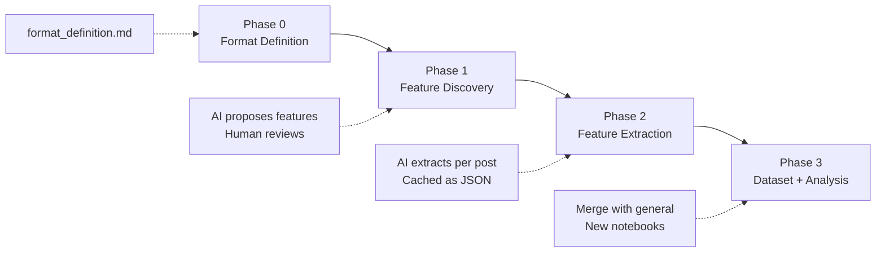

# Format Analysis Pipeline

## Part 1: Rename General Analysis Files

All existing analysis artifacts get reorganized under a "general" label. This is a structural rename with code path updates.

### Files to move/rename

**Notebooks** (move to `notebooks/general/`):

- `notebooks/01_eda.ipynb` --> `notebooks/general/01_eda.ipynb`
- `notebooks/02_feature_importance.ipynb` --> `notebooks/general/02_feature_importance.ipynb`
- `notebooks/03_modeling.ipynb` --> `notebooks/general/03_modeling.ipynb`
- `notebooks/04_clustering.ipynb` --> `notebooks/general/04_clustering.ipynb`
- `notebooks/05_all_features.ipynb` --> `notebooks/general/05_all_features.ipynb`

**Root reference file:**

- `features_reference.json` --> `general_features_reference.json`

**Data outputs:**

- `data/features_cache/` --> `data/general_features_cache/`
- `data/processed/genna_dataset.parquet` --> `data/processed/general_dataset.parquet`
- `data/processed/genna_dataset.csv` --> `data/processed/general_dataset.csv`

**Documentation:**

- `PROJECT_PLAN.md` --> `PROJECT_GENERAL_ANALYSIS.md`

### Code references to update

Each change below is a direct consequence of the renames above:

- **[scripts/config.py](scripts/config.py):** Update `FEATURES_REF`, `FEATURES_CACHE_DIR`, `DATASET_PARQUET` paths
- **[scripts/build_dataframe.py](scripts/build_dataframe.py):** Update hardcoded CSV name `genna_dataset.csv` --> `general_dataset.csv`
- **All 5 notebooks:** Update `PROJECT_ROOT = Path.cwd().parent` --> `Path.cwd().parent.parent` (one extra level for subfolder)
- **[notebooks/05_all_features.ipynb](notebooks/05_all_features.ipynb):** Update hardcoded `features_reference.json` path
- **[CLAUDE.md](CLAUDE.md):** Update folder structure docs to reflect new layout

---

## Part 2: Format Analysis Pipeline (PROJECT_FORMAT_ANALYSIS.md)

### Core Concept

The 62 general features describe **any** Instagram post (duration, cuts, face presence, etc.). Format features describe what makes **your specific type of content** tick. A gameplay channel needs features about game genre and kill highlights. A business storytelling channel (like Genna) needs features about whether the story is about a company or a person, whether the topic is business or pop culture, how many presenters appear, and how strong the "revelation moment" is.

The pipeline has 4 phases:




### Phase 0 -- Format Definition

Create `format_definition.md` at the project root. This is a human-written document that describes the content format in natural language. Example structure:

```markdown
# Content Format: Business Storytelling Reels

## Description
Short vertical videos (60-100s) where presenters reveal the 
"hidden engineering" behind companies and personal brands.

## Key Elements
- 1-3 on-camera presenters telling a story
- Plot twist / revelation structure
- Topics: company histories, marketing strategies, brand positioning
- Tone: provocative, engaging, colloquial Brazilian Portuguese

## What varies between good and bad posts?
- Strength of the "big idea" / plot twist
- Presenter energy and delivery
- Whether the story is relatable to the target audience
- Balance between entertainment and education
```

This file is the "prompt seed" for the discovery phase.

### Phase 1 -- Feature Discovery (AI-assisted, human-curated)

**New script:** `scripts/format/discover_features.py`

**How it works:**

1. Reads `format_definition.md`
2. Selects a **stratified sample of 25 posts** across the full performance spectrum (by Reach):
  - 5 posts from the **bottom** (0-25th percentile)
  - 5 posts from the **25th percentile** range
  - 5 posts from the **median** range (around 50th percentile)
  - 5 posts from the **75th percentile** range
  - 5 posts from the **top** (75-100th percentile)
3. For each sample post, prepares: caption + Whisper transcript + 3-5 key frames
4. Sends everything to a high-quality AI model with a meta-prompt:

> "Given this content format definition and these 25 sample posts (spanning worst to best performance), propose 15-25 features that are SPECIFIC to this content format. Do NOT propose general video features (we already track 62 of those: duration, cuts, face presence, etc.). Focus on what distinguishes a GREAT post in this format from a mediocre one. For each feature, provide: name, description, possible_values (categorical or numeric range), and why it matters."

5. Model returns structured JSON with proposed features
6. Script generates **`format_features_review.md`** — a human-friendly Markdown file for review
7. Script prints: *"Review and edit: format_features_review.md — when done, run: python -m scripts.format.pipeline confirm"*

**The review file** (`format_features_review.md`) uses a clean, parseable Markdown structure:

```markdown
# Format Features -- Review
> Edit freely: rename features, rewrite descriptions, add/remove
> categories, delete entire sections.
> When done, run: python -m scripts.format.pipeline confirm

---

## 1. storytelling_subject
**Description:** The main storytelling angle of the video

**Categories:**
- `company_history` -- Story about a company's origin or evolution
- `person_behind` -- Story focused on the founder or key person
- `strategy_breakdown` -- Dissecting a specific business strategy
- `trend_analysis` -- Analyzing a market trend or shift

---

## 2. presenter_identity
**Description:** Which presenter(s) appear in the video
**Type:** multi-select

**Categories:**
- `man_1` -- Main male presenter (presenter_a)
- `woman_1` -- Main female presenter (presenter_b)
- `woman_2` -- Second female presenter (presenter_c)
- `other` -- Guest or unidentified presenter

---

## 3. revelation_strength
**Description:** How surprising is the plot twist / big idea
**Type:** numeric (1-5)

**Scale:**
- `1` -- Predictable, no real surprise
- `3` -- Interesting angle, somewhat unexpected
- `5` -- Genuinely surprising, reframes how you see the subject
```

Design rationale:

- H2 = feature name (rename by editing the header)
- Bold labels = metadata (description, type)
- Bullet list with backtick codes = categories/scale with descriptions
- Delete an entire `## section` to remove a feature; add a new section to create one
- Renders beautifully in Cursor's Markdown preview

### Phase 1.5 -- Human Review + Confirm

**CLI command:** `python -m scripts.format.pipeline confirm`

**What it does:**

1. Parses `format_features_review.md` back into structured data
2. Validates: every feature has a name, description, and at least 2 categories/scale points
3. Shows a summary: *"18 features confirmed (2 removed, 1 added vs. original proposal)"*
4. Saves the final version as **`format_features_reference.json`**
5. Prints: *"Ready for extraction. Run: python -m scripts.format.pipeline extract"*

If parsing fails (malformed section), the script prints the exact line/section with the issue so the user can fix it and re-run `confirm`.

**Example features for Genna's format:**

- `storytelling_subject`: company_history / person_behind / strategy_breakdown / trend_analysis
- `cultural_domain`: business / pop_culture / tech / mixed
- `presenter_identity`: man_1 / woman_1 / woman_2 / other (AI identifies recurring presenters by appearance and assigns consistent labels)
- `presenter_energy_level`: low / medium / high
- `revelation_strength`: 1-5 (how surprising is the plot twist)
- `narrative_complexity`: simple / layered / multi_arc
- `audience_relatability`: niche_professional / broad_business / mainstream
- `specific_numbers_cited`: true / false (does it cite revenue, growth %, etc.)
- ...and 10-15 more

### Phase 2 -- Feature Extraction

**New script:** `scripts/format/extractor.py`

Mirrors the general pipeline's extractor pattern ([scripts/extractors/base.py](scripts/extractors/base.py)):

- Inherits from or mirrors `BaseExtractor`
- For each post: sends key frames + transcript + caption to AI model
- Prompt includes the confirmed `format_features_reference.json` with feature names, descriptions, and possible values
- Response parsed as structured JSON
- Cached at `data/format_features_cache/{timestamp}.json`

**Key difference from general extractors:** Video cannot be sent directly to all models, so the extractor prepares a "content package" per post:

- **Caption** (text)
- **Whisper transcript** (from general pipeline -- already extracted)
- **Key frames** (3-5 evenly-spaced frames extracted via OpenCV, sent as images)
- **General features** (optional context: the 62 already-extracted values)

**New orchestrator:** `scripts/format/pipeline.py`

The CLI has 4 commands reflecting the human-in-the-loop flow:

```
python -m scripts.format.pipeline discover   # Phase 1: AI proposes → review.md
python -m scripts.format.pipeline confirm     # Phase 1.5: Parse review.md → reference.json
python -m scripts.format.pipeline extract     # Phase 2: Extract features for all posts
python -m scripts.format.pipeline all         # Runs discover only (confirm requires human)
```

### Phase 3 -- Dataset Building + Analysis

**New script:** `scripts/format/build_format_dataset.py`

- Loads `data/processed/general_dataset.parquet` (the general analysis output)
- Loads all `data/format_features_cache/*.json`
- Left-merges on `timestamp`
- Outputs `data/processed/format_dataset.parquet` (general + format features combined)

**New notebooks** in `notebooks/format/`:

- `01_eda.ipynb` -- EDA of format-specific features, distributions, correlations with metrics
- `02_feature_importance.ipynb` -- Which format features predict performance? Compare against general features
- `03_combined_modeling.ipynb` -- Predictive models using general + format features together (does adding format features improve prediction?)
- `04_all_features.ipynb` -- Per-feature breakdown tables (same style as general `05_all_features.ipynb`)

### Final Project Structure

```
maquina de conteudo/
├── CLAUDE.md
├── PROJECT_GENERAL_ANALYSIS.md      (renamed from PROJECT_PLAN.md)
├── PROJECT_FORMAT_ANALYSIS.md       (new)
├── general_features_reference.json  (renamed from features_reference.json)
├── format_definition.md             (new -- user writes this)
├── format_features_reference.json   (new -- AI-proposed, human-approved)
│
├── scripts/
│   ├── config.py                    (updated paths)
│   ├── prepare_data.py              (unchanged -- shared infrastructure)
│   ├── pipeline.py                  (unchanged -- general pipeline)
│   ├── build_dataframe.py           (updated output names)
│   ├── extractors/                  (unchanged -- general extractors)
│   └── format/                      (new)
│       ├── __init__.py
│       ├── discover_features.py     (Phase 1)
│       ├── extractor.py             (Phase 2)
│       ├── pipeline.py              (orchestrator)
│       └── build_format_dataset.py  (Phase 3)
│
├── notebooks/
│   ├── general/                     (moved from notebooks/)
│   │   ├── 01_eda.ipynb
│   │   ├── 02_feature_importance.ipynb
│   │   ├── 03_modeling.ipynb
│   │   ├── 04_clustering.ipynb
│   │   └── 05_all_features.ipynb
│   └── format/                      (new)
│       ├── 01_eda.ipynb
│       ├── 02_feature_importance.ipynb
│       ├── 03_combined_modeling.ipynb
│       └── 04_all_features.ipynb
│
├── data/
│   ├── general_features_cache/      (renamed from features_cache/)
│   ├── format_features_cache/       (new)
│   └── processed/
│       ├── posts_base.parquet       (unchanged -- shared)
│       ├── general_dataset.parquet  (renamed from genna_dataset.parquet)
│       ├── general_dataset.csv      (renamed from genna_dataset.csv)
│       └── format_dataset.parquet   (new)
```

### Model Choice for Format Pipeline

The feature discovery step (Phase 1) needs a high-quality model capable of nuanced content analysis. The extraction step (Phase 2) can use a more cost-effective model since it follows a structured prompt. Recommended:

- **Discovery:** GPT-4o or Claude Sonnet (best reasoning for creative feature proposal)
- **Extraction:** Gemini Flash or GPT-4o-mini (structured extraction, lower cost per post)

Both are already configured in `.env` (OpenAI and Google keys). If using Anthropic, add `ANTHROPIC_API_KEY` to `.env`.
